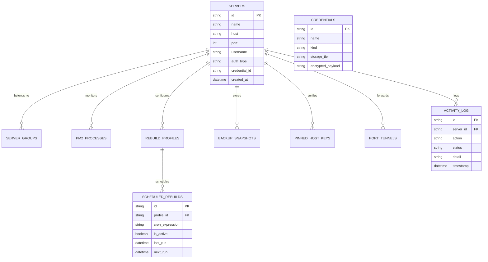

# 🏛️ Server Command Center: Architecture & Technical Blueprint

### Powered by [Falah Tech](https://falah-tech.com)

This document provides a comprehensive technical overview of the architecture, data flow, component hierarchy, and security layers of **Server Command Center**, powered by **[Falah Tech](https://falah-tech.com)**.

---

## 1. System Topology Overview

Server Command Center uses an asynchronous, hybrid client-native architecture powered by **Tauri v2**:

```mermaid
graph TB
    subgraph Frontend["React 19 Frontend (TypeScript)"]
        UI_Shell["AppShell & Dynamic Viewport (100dvh)"]
        Nav_Desktop["Sidebar & TopBar (Desktop)"]
        Nav_Mobile["MobileBottomNav & Slide Drawer (Mobile)"]
        Cockpit["Server Cockpit & Tabs (Overview, PM2, Rebuild, SFTP, Terminal, Security, Backups)"]
        Stores["Zustand Stores (ui-store, use-vault-store, ui-notifications)"]
        Query["TanStack React Query (Server Fleet State Cache)"]
    end

    subgraph IPC_Bridge["Tauri v2 IPC Bridge"]
        Invoke["tauri::invoke (Strict Serde DTOs)"]
        Events["tauri::Emitter (Live Log & Terminal Event Streams)"]
    end

    subgraph Rust_Backend["Tauri v2 Rust Backend (Async Tokio Engine)"]
        App_State["AppState (Arc Mutex Shared State)"]
        SSH_Manager["russh & russh-keys Multiplexer"]
        Redact_Engine["Regex Stream Secret Redaction Engine"]
        Scheduler["Tokio Background Cron Rebuild Scheduler"]
        Pty_Engine["Tokio Async PTY / Terminal IO Channels"]
    end

    subgraph Security_Storage["Storage & Enclave Layer"]
        SQLite["Local SQLite (rusqlite with Migrations 0001-0005)"]
        DPAPI["Windows DPAPI / Credential Manager (Tier 1)"]
        WinHello["Windows Hello TPM 2.0 UserConsentVerifier (Tier 2)"]
        Argon2_Vault["Argon2id + AES-256-GCM Encrypted File Vault (Tier 3)"]
    end

    UI_Shell --> Nav_Desktop
    UI_Shell --> Nav_Mobile
    UI_Shell --> Cockpit
    Cockpit --> Stores
    Cockpit --> Query
    Stores --> Invoke
    Query --> Invoke
    
    Invoke --> App_State
    Events <.. Pty_Engine
    Events <.. Redact_Engine

    App_State --> SSH_Manager
    App_State --> Scheduler
    App_State --> Pty_Engine
    
    SSH_Manager --> Redact_Engine
    Pty_Engine --> Redact_Engine
    
    App_State --> SQLite
    App_State --> DPAPI
    App_State --> WinHello
    App_State --> Argon2_Vault
```

---

## 2. Frontend Architecture (React 19 + TypeScript)

### Component Hierarchy
```
src/
├── app/
│   ├── layout/
│   │   ├── AppShell.tsx            # Main shell, 100dvh viewport, pb-14/pb-0 padding
│   │   ├── TopBar.tsx              # Quick search, Vault timer pill, theme toggle, hamburger
│   │   ├── Sidebar.tsx             # Collapsible desktop menu + mobile slide-out drawer
│   │   └── MobileBottomNav.tsx     # 5-item thumb bar for smartphones
│   └── routes/
│       ├── Dashboard.tsx           # Server fleet grid & group cards
│       ├── ServerDetail.tsx        # Multi-tab cockpit for a specific server
│       ├── Activity.tsx            # Audit telemetry & action history
│       └── Settings.tsx            # Vault credentials, biometric setup, known hosts
├── features/
│   ├── pm2/                        # Process tables, actions, restart/reload/stop
│   ├── rebuild/                    # Pipelines, wizard, automated cron editor
│   ├── terminal/                   # Xterm.js instance + MobileTerminalToolbar.tsx
│   ├── files/                      # SFTP manager, remote chmod modal, editor
│   ├── security/                   # Sockets list, UFW firewall rules, SSH hardening
│   ├── nginx/                      # Virtual host inspector, SSL status
│   ├── tunnels/                    # SSH port forwarding manager
│   ├── backups/                    # Database dumps & filesystem snapshots
│   └── vault/                      # Credentials list, Windows Hello biometric toggle
├── stores/                         # Zustand global states (UI, vault session)
├── lib/
│   ├── tauri-client.ts             # Strongly-typed IPC wrapper functions
│   └── error-handler.ts            # Global error toast & formatting handler
└── types/                          # Shared TypeScript interfaces & DTOs
```

### Mobile-First Layout Principles
1. **Dynamic Viewport (`100dvh`)**: Mobile browsers dynamically resize their viewports when navigation bars or software keyboards appear. `100dvh` ensures no visual jitter or layout breaks.
2. **Safe-Area Insets**: Navigation elements consume `env(safe-area-inset-bottom)` so buttons are never masked by iPhone home indicators or Android gesture bars.
3. **Soft-Key Terminal Bar**: Because mobile keyboards do not have `ESC`, `TAB`, `Ctrl+C`, or arrow keys, [`MobileTerminalToolbar.tsx`](file:///d:/projects/Veyra/server-command-center/src/features/terminal/components/MobileTerminalToolbar.tsx) injects these control characters directly into the PTY channel.

---

## 3. Backend Architecture (Rust + Tokio)

### Subsystem Breakdown

| Subsystem | Source Location | Implementation Details |
| :--- | :--- | :--- |
| **Command Bridge** | `src-tauri/src/commands/` | Granular modular commands for servers, credentials, PM2, logs, rebuilds, SFTP, security, tunnels, and backups. |
| **SSH Multiplexer** | `src-tauri/src/ssh/` | Built on `russh` and `russh-keys`. Maintains persistent async channels for command execution and PTY sessions. |
| **Secret Redaction** | `src-tauri/src/secrets/redact.rs` | Comprehensive regex patterns matching PEM keys, passwords, database URLs, and bearer tokens. |
| **Vault & Biometrics** | `src-tauri/src/secrets/` | 3-tier architecture: Windows DPAPI, Windows Hello (`UserConsentVerifier`), and Argon2id file vault. |
| **Database Layer** | `src-tauri/src/db/` | Embedded `rusqlite` database executing SQL migrations sequentially on startup. |
| **Scheduled Tasks** | `src-tauri/src/commands/scheduled_rebuilds.rs` | Background Tokio loop checking active cron schedules and executing pipelines unattended. |

---

## 4. Database Schema & SQLite Migrations

The local database is stored under `%APPDATA%\com.servercommandcenter.app\server_command_center.db`:



---

## 5. Security & Threat Model

1. **Zero Secret Logging**:
   - `println!`, `eprintln!`, `dbg!`, and tracing output are stripped of secrets.
   - All structs representing credentials implement manual `std::fmt::Debug` printing `"[REDACTED]"`.
2. **Memory Zeroization**:
   - All sensitive buffers are wrapped in `zeroize::Zeroizing<T>` or `ZeroizeOnDrop` so memory is cleared with zeros immediately when out of scope.
3. **Hardware-Backed Biometrics**:
   - Biometric authentication delegates directly to the Windows TPM 2.0 enclave via `UserConsentVerifier`. Passwords never leave encrypted storage unless biometrically authorized.
4. **Host Key Pinning**:
   - Eliminates Man-In-The-Middle (MITM) attacks by persisting known public keys and alerting users if a remote key changes unexpectedly.

