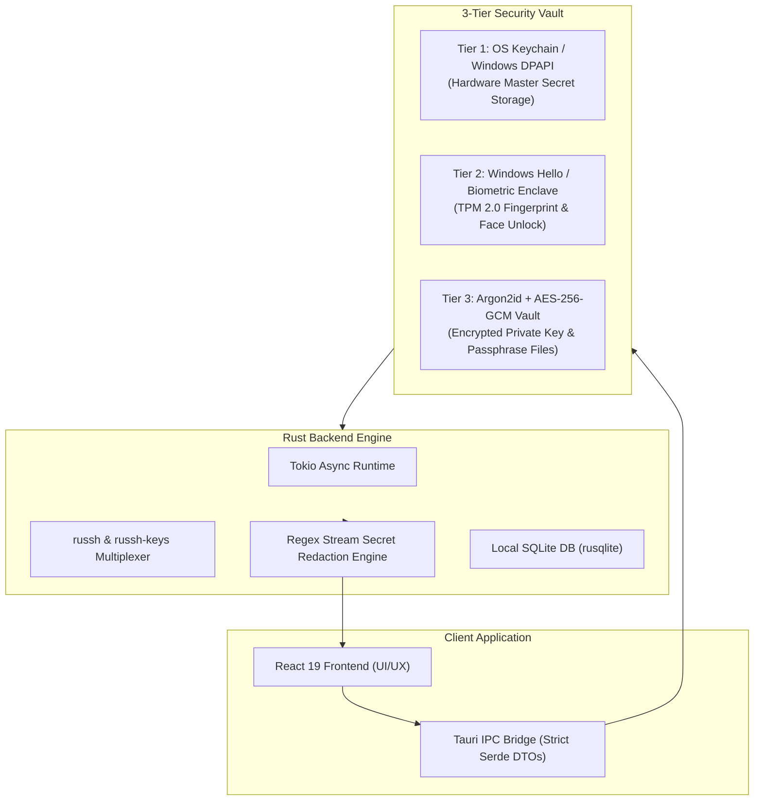

<div align="center">

# ⚡ SERVER COMMAND CENTER

### **Mission-Control Infrastructure Cockpit for Cloud Fleets, PM2 Workloads, and Zero-Downtime Deployments**
### **Powered by [Falah Tech](https://falah-tech.com)**

[](https://tauri.app/)
[](https://www.rust-lang.org/)
[](https://react.dev/)
[](https://tailwindcss.com/)
[](https://learn.microsoft.com/windows/security/)
[](https://falah-tech.com)

<br/>

**Server Command Center** is a modern, high-performance desktop and mobile engineering cockpit designed for DevOps engineers, full-stack developers, and cloud administrators, powered by **[Falah Tech](https://falah-tech.com)**. Built with a native **Rust (Tauri v2)** backend and an ultra-responsive **React 19** frontend, it replaces clunky web dashboards and scattered terminal windows with a unified, hardware-secured control panel.

[Download Windows Installer (.exe)](RELEASES.md) • [Android Mobile APK (.apk)](RELEASES.md) • [Technical Architecture](ARCHITECTURE.md) • [Security & Vault Policy](SECURITY.md)

</div>

---

## 🌟 Key Capabilities

### 🖥️ 1. Multi-Server Fleet Cockpit
- **Live Fleet Health Telemetry**: Instant connection probing, uptime monitoring, load averages, memory, and disk usage across unlimited Linux instances.
- **Hierarchical Server Grouping**: Organize servers by environment (`Production`, `Staging`, `Development`, `Edge`) or custom client groups with collapsible tree navigation.
- **Fast Search & Palette (`Ctrl+K`)**: Rapidly search and jump directly to servers, PM2 processes, open ports, or remote directories.

### 🔄 2. PM2 Process Lifecycle & Live Streaming Logs
- **Process Orchestration**: Start, restart, reload (zero-downtime cluster reload), stop, and delete PM2 services with one tap.
- **Real-time Log Telemetry**: Stream remote `pm2 logs` and `/var/log` files over multiplexed Tokio async channels directly into virtualized log viewers with keyword search, regex filtering, and pause/resume controls.
- **Sanitized Process Details**: Automatically redacts sensitive environment variables (`API_KEY`, `DATABASE_URL`, `JWT_SECRET`, etc.) before rendering in UI tables.

### 🚀 3. Zero-Downtime Rebuild & Deployment Deck
- **Parallel Atomic Pipeline**: Automated multi-step pipelines (`git pull` → isolated tmp sync → cached dependency install → staged build → atomic `.next` swap → `pm2 reload`).
- **One-Click Rebuild Profiles**: Pre-configure reusable build pipelines for Next.js, NestJS, Bun, Node, or custom Docker microservices.
- **Automated Cron Rebuild Scheduler**: Schedule automated off-peak rebuilds (daily, weekly, or custom cron expressions) directly stored in the local SQLite engine.

### 💻 4. Hardware-Accelerated Terminal & Mobile Soft-Keys
- **Full PTY Emulation**: Integrated Xterm.js terminal with UTF-8 character rendering, cursor blinking, ANSI colors, and window resize listeners (`TIOCSWINSZ`).
- **Mobile Soft-Key Bar**: Dedicated on-screen thumb buttons for mobile devices (`ESC`, `TAB`, `^C` SIGINT, `^D` EOF, arrow keys `↑` `↓` `←` `→`, pipe `|`, `~`, `/`, and `Enter`).
- **Multi-Tab Sessions**: Spawn and toggle between multiple active SSH sessions without losing terminal state.

### 📁 5. Native SFTP Remote File Manager
- **File System Operations**: Browse, search, upload, download, rename, and delete remote files.
- **Remote Chmod & Permission Manager**: Interactive octal chmod calculator (`0755`, `0644`, etc.) with user/group/world read-write-execute checkboxes.
- **Built-in Remote Code Editor**: In-app code editor with syntax highlighting for inspecting and modifying remote configurations on the fly.
- **SFTP Path Bookmarks**: Fast one-click shortcuts to key directories (`Home ~`, `/var/www`, `/etc/nginx`, `/var/log`, `/tmp`, `Root /`).

### 🛡️ 6. Security Audit & Firewall Inspector
- **Listening Sockets & Port Inspector**: Live parsing of `ss -tulpn` displaying PID, process name, protocol, and binding (`Public Internet` vs. `Localhost Safe`).
- **Interactive UFW Firewall Controller**: View active rules, add new port rules (`ALLOW`, `DENY`), toggle default incoming policies, and delete obsolete rules with immediate feedback.
- **SSH Hardening Engine**: Live automated audit of `/etc/ssh/sshd_config` checking for direct root login, password authentication vulnerabilities, and default port 22 exposure, generating actionable hardening scores (0–100).

### 🌐 7. Nginx Proxy Manager & Port Tunnels
- **Nginx Virtual Hosts Inspector**: Visual breakdown of `/etc/nginx/sites-enabled/`, server blocks, reverse proxy targets, upstream clusters, and SSL certificate expiration indicators.
- **Active SSH Port Forwarding**: Establish secure local/remote tunnels (`localhost:5432` $\to$ remote database port) directly through your existing SSH connection without exposing ports to the public internet.

### 💾 8. Automated Remote Database & Storage Backups
- **Database Engine Support**: Direct execution of `pg_dump` (PostgreSQL), `mongodump` (MongoDB), `mysqldump` (MySQL/MariaDB), and `tar.gz` filesystem archives.
- **Backup Inventory & One-Click Restore**: History of created snapshots with remote sizes, timestamps, and automated rollback/restore triggers.

---

## 🔒 3-Tier Enterprise Security Architecture



1. **Tier 1: OS Keychain / DPAPI**: Operating system hardware-backed credentials store (Windows Credential Manager / DPAPI) encrypts SSH passwords and passphrases with zero plain-text storage on disk.
2. **Tier 2: Windows Hello TPM Biometrics**: 1-click biometric unlock (Fingerprint, Facial Recognition, or PIN) verified via the Windows UserConsentVerifier API through TPM 2.0 enclave.
3. **Tier 3: Argon2id File Vault**: Custom master-password vault for sensitive SSH private key pairs. Keys in memory are protected using `ZeroizeOnDrop` buffers and discarded upon session lock or inactivity timeout.
4. **Automated Stream Sanitization**: All terminal streams, PM2 logs, rebuild outputs, and activity history entries pass through an automated regex scrubbing filter (`redact_secrets`) before reaching SQLite or the UI.

---

## 📱 Mobile-First Responsive Architecture

Server Command Center is engineered from the ground up for both wide desktop command stations and mobile phone touch screens:

- **Dynamic Viewport (`100dvh`)**: Immune to address bar jumps and Android on-screen keyboards.
- **Thumb Navigation Bar**: 5 key destinations (`Servers`, `Activity`, `Search`, `Vault`, `Settings`) positioned at the bottom of the screen with iOS/Android safe-area inset support (`env(safe-area-inset-bottom)`).
- **Mobile Terminal Toolbar**: On-screen soft keys (`ESC`, `TAB`, `^C`, `^D`, arrow navigation, pipes, and slashes) specifically built for typing terminal commands on glass.
- **Horizontal Smooth Scrollers**: Cockpit tabs glide horizontally with touch swipe and edge-fade indicators.

---

## 📦 Releases & Binaries

| Platform | Format | Release File | Notes |
| :--- | :--- | :--- | :--- |
| **Windows 10/11 x64** | Setup Installer (`.exe`) | `Server Command Center_1.0.0_x64-setup.exe` | Silent install `/S`, Start Menu & Desktop shortcuts |
| **Windows 10/11 x64** | Portable Binary (`.exe`) | `server-command-center.exe` | Standalone, no installation required |
| **Android 8.0+ (API 26+)** | Mobile Package (`.apk`) | `server-command-center.apk` | Compatible with `aarch64` and `armv7` devices |

*For checksums, install instructions, and previous releases, see [RELEASES.md](RELEASES.md).*

---

## 🛠️ Development & Building from Source

### Prerequisites
- [Rust](https://www.rust-lang.org/) (version 1.80+ or latest stable `x86_64-pc-windows-msvc`)
- [Node.js](https://nodejs.org/) (version 20+ or 24+)
- [C++ Build Tools for Visual Studio 2022+](https://visualstudio.microsoft.com/visual-cpp-build-tools/)
- For Android: Android Studio, Android SDK Platform 34+, and NDK (r25+)

### Quick Start

```powershell
# 1. Clone repository
git clone https://github.com/Abdulllah321/Veyra.git
cd Veyra/server-command-center

# 2. Install frontend dependencies
npm install

# 3. Run in Desktop Development Mode
npm run tauri dev
```

### Production Build

```powershell
# Build Windows Installer & Portable Binary
npm run tauri build

# Output location:
# src-tauri/target/release/server-command-center.exe
# src-tauri/target/release/bundle/nsis/Server Command Center_1.0.0_x64-setup.exe
```

---

## 📚 Project Documentation

- [Release Notes & Downloads](RELEASES.md) — Detailed changelog, binary verification, and distribution artifacts.
- [Architecture Blueprint](ARCHITECTURE.md) — Frontend & Rust IPC data flow, database schema, and mobile lifecycle.
- [Security Audit & Disclosure](SECURITY.md) — Full security audit report, zeroization policy, and vulnerability guidelines.
- [Contributing Guidelines](CONTRIBUTING.md) — Coding conventions, Tauri command patterns, and PR workflow.

---

## ⚖️ License & Authors

Designed and built by **Abdullah Sufyan** (`Abdulllah321`).  
Powered by **[Falah Tech](https://falah-tech.com)**.  
Copyright © 2026 Falah Tech. All Rights Reserved.
